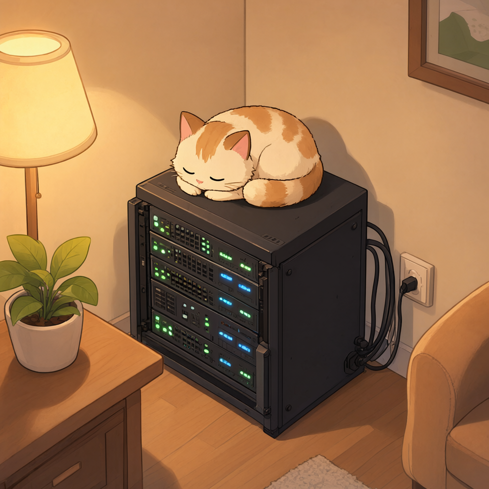

# stacks

<!-- Hero image: generated locally with Qwen-Image-2.1 (ComfyUI), seed 968889135 -->
<p align="center">
  
</p>

Docker Compose configurations for a homelab running on a single host
(`/opt/stacks`). Each subdirectory is one stack. All secrets are kept
outside this repository in `/opt/secrets/<stack>.env` and loaded via
`env_file` — nothing secret is ever committed.

## Layout

| Stack              | What it is                                            |
| ------------------ | ----------------------------------------------------- |
| `audiobookshelf`   | Audiobookshelf + calibre-web (ebooks) + storyteller    |
| `cloudflare`       | Cloudflare Tunnel (remote access)                      |
| `code-server`      | VS Code in the browser (Tailscale-only access)         |
| `freshrss`         | RSS reader                                             |
| `immich`           | Photo library (server, ML, redis, postgres)            |
| `jellyfin`         | Media server                                           |
| `llama-cpp`        | llama.cpp OpenAI-compatible server (GPU)               |
| `litellm`          | LiteLLM proxy with idle-stop / on-demand start         |
| `mcp-searxng`      | SearXNG MCP server for AI assistants                   |
| `memos`            | Lightweight note-taking                                 |
| `navidrome`        | Music streaming                                        |
| `ntfy`             | Push notifications                                     |
| `ollama`           | Ollama model runner (ROCm)                             |
| `opencode-web`     | opencode web UI via systemd (Tailscale-only access)    |
| `paperless`        | Document management (paperless-ngx)                    |
| `portainer`        | Container management UI                                |
| `trilium`          | TriliumNext notes                                       |
| `watchtower`       | Automatic container image updates                      |

## Secrets

Secrets live in `/opt/secrets/<stack>.env`, loaded by compose via
`env_file`. They are not part of this repository.

- [x] git-secret-hunter (gitleaks) pre-commit hook runs on every commit
- `.gitignore` excludes `.env*`, data/runtime directories, and backups
- `*.env.example` files are committed instead with placeholder values

## Security watch

`scripts/security-watch.py` is a standard-library-only Python security briefing
runner. It inventories the **main host and configured SSH hosts**, queries OSV for selected npm/Python
versions and CISA's known-exploited catalog, then asks a dedicated Mistral Studio
web-search agent to research applicability and supply-chain incidents. It never
patches anything, changes containers, or executes model-generated commands. Each
run also fetches the repository's `dependabot/*` remote branches (scoped refspec;
no working-tree changes) so pending image-update PRs are listed in the report and
announced in the ntfy summary.

```bash
# Sanitized local/SSH inventory: no LLM/API calls, API-key reads, or alerts
python3 -S scripts/security-watch.py --inventory

# Create/reconcile only the dedicated agent after editing its tracked settings
python3 -S scripts/security-watch.py --setup-agent

# Manual research report, without notifications
python3 -S scripts/security-watch.py

# Research and notify about new/changed actionable findings and check failures
python3 -S scripts/security-watch.py --notify

# Offline tests; no credentials, network, or live container changes
python3 -S -B -m unittest discover -s scripts -p test_security_watch.py -v
```

Settings live in `scripts/security-watch.json`; the agent's instructions live in
`scripts/security-watch-prompt.txt`. After changing the model, prompt, token limit,
or response settings, run `--setup-agent` to apply them to **this agent only**.
Normal runs verify its configuration before using it. Other Studio agents are
not modified. The runner reads `MISTRAL_API_KEY` from `/opt/secrets/mistral.env`
and stores its agent ID in `/opt/secrets/security-watch.json`; the key is never
included in prompts or logs. Conversations use `store: false` (no saved Mistral
conversation history; this is not a promise about all provider logging).

The model is pinned to **`zai-glm-5-3`** (high reasoning, 65,536-token
completion limit, no automatic or price-changing fallback). The agent returns
JSON as plain text because forced JSON decoding prevents its web search;
reports are validated locally against the expected fields, classifications,
observed versions and source URLs. Avoid `latest` aliases: the API's
deprecation fields can lag the published
[lifecycle notices](https://docs.mistral.ai/inference/model-lifecycle).

Reports and delivery state are private files in
`~/.local/state/security-watch/` (directory `0700`, files `0600`):

- `latest.json` — last validated report, inventory, coverage, source checks,
  original assessments (including not-affected evidence), and usage.
- `latest.md` — readable current briefing, including not-affected evidence.
- `reports/*.json` and `reports/*.md` — dated reports, retained for 30 days.
- `notified.json` — successfully delivered finding fingerprints; manual reports
  do not consume alerts, and failed deliveries remain retryable.
- `dependabot.json` — Dependabot update branches already announced; same
  delivery semantics (manual runs do not consume them, failures retry).
- `last-run.log` — output of the scheduled run, overwritten each run.

Each validated, high-confidence resolution is handled independently; an
unrelated rejected research claim does not keep it open. Carried findings also
receive conservative package reconciliation: exact distro package revisions are
compared with previously confirmed fixes; Python/npm findings require an
authoritative OSV advisory-to-package identity, a current version meeting the
recorded fix, and an explicit successful OSV query receipt for that exact current
package version. Any remaining match for the package blocks automatic clearing,
including CVE/PYSEC aliases or unrelated advisories (conservative by design).
Missing or ambiguous evidence and same-finding conflicts do not clear a finding.
These resolutions appear in the report;
unverified carry-over items are separated under **Historical findings**, with
their installed-version text explicitly identified as old evidence.

For Paperless advisories absent from OSV, an allowlisted fallback reads the
official `paperless-ngx/paperless-ngx` repository advisory API. It validates the
published advisory ID/source and requires the expected running image plus a
runtime-probed application version strictly newer than every listed patched
version. Unknown versions, complex patch ranges, exact boundary equality, or
conflicting assessments remain unresolved. This handles repository-only GHSAs
without assuming a global-index 404 means the advisory does not exist.

Runs **daily at 07:00 Europe/Vienna** from the existing user crontab; the daily
07:00 server-health entry is unchanged. The command is
`/usr/bin/python3 -S /opt/stacks/scripts/security-watch.py --notify`, redirecting
output to `~/.local/state/security-watch/last-run.log`. To disable it, remove
only the security-watch entry with `crontab -e`. Live inventory, findings and
delivery records stay in private runtime state, never in this repository.

### Remote inventory over existing SSH

Inventory collection is deterministic code, not an LLM operation. The main host
streams its fixed, read-only collector to `python3 -S -B -` over SSH; nothing is
installed on remote hosts. It collects OS/kernel, selected distro packages
(including OMV/PHP/kernel packages), locally cached pending updates and Docker
image/version metadata when the existing user already has access. Remote Python
dependency probing is not enabled. No sudo or new Docker-group membership is
requested.

The connection list is private: `remote_hosts_file` points to
`/opt/secrets/security-watch-hosts.json` (mode `0600`). Example structure, with
placeholder targets to replace locally:

```json
[
  {"alias": "nas", "target": "user@nas.example"},
  {"alias": "dns", "target": "user@dns.example"}
]
```

Use an existing SSH alias, hostname or IPv4 target, optionally with `user@`.
SSH uses the cron user's existing keys with `BatchMode=yes`, strict known-host
verification, connection/whole-collector timeouts and no agent/port forwarding.
There are no new accounts or keys; existing SSH permissions are unchanged.
Keys must work without an interactive passphrase/agent prompt in cron. Set up
and verify host keys interactively yourself if they are not already known;
the runner never automatically accepts them.

Only the sanitized result goes to research, never SSH targets, usernames,
connection stderr or credentials. Remote containers use IDs such as `nas:app`;
remote distro packages use `host:nas:openssl`, retaining each host's distro
context. An unreachable host remains a coverage gap and makes the research run
partial (exit `2`, with a failure notice when `--notify` is enabled). To opt out
of remote collection, remove `remote_hosts_file` from the configuration.

### Scope and safeguards

- Inventory contains allowlisted product/version information, a host alias,
  and exposure categories. It does not include Docker environments, credentials,
  raw configuration, private registry domains, IP addresses or host paths.
- Runtime binary/Python/npm versions are preferred. Image tags/labels are marked
  as hints; inherited Ubuntu/uv labels must not masquerade as app versions.
  Tool requirement pins are explicitly marked as declared, not runtime verified.
- Unknown exposure is not assumed private. Cloudflare Access is context, not
  proof that a vulnerability is fixed or irrelevant.
- Host package assessment requires distro-aware research because of backports.
  The script only reads the local apt cache; it does not refresh or upgrade it.
- This is **not a full image or transitive-dependency scan**. Unconfigured hosts, custom
  app dependencies and unexamined components remain explicit coverage gaps.
  Existing Dependabot checks remain complementary.
- Findings require source URLs observed in actual search/advisory results.
  These citations establish provenance, not a guarantee that an LLM interpreted
  them correctly. Review urgent advice against the original advisory.
- Application package/version matches are conservatively classified `possible`,
  even if the model claims `confirmed`: installed metadata cannot establish use
  of an affected transport, parser, build type or code path. These can still
  generate update recommendations, not claims of confirmed exploitability.
- A bad individual assessment is excluded, recorded in limitations, and cannot
  alert or dismiss a prior issue. If any are excluded, the model's summary is
  replaced with a factual partial-report notice and the run returns `2`. Sound
  findings can still notify; a completely invalid report is rejected outright.
- Omitted prior findings remain marked not rechecked. Partial source failures
  cannot dismiss existing findings. A failed run returns exit code `2` and,
  with `--notify`, sends a failure alert rather than an all-clear message.
- Explicit high-confidence resolutions apply only to researched components;
  unrelated coverage gaps do not block them. Source failures or rejected claims
  still prevent resolution.
- Pushes summarize up to eight findings and explicitly count any additional
  ones; the complete briefing stays local rather than being silently truncated.
- A lock prevents concurrent research runs. A 15-minute deadline bounds the
  whole run. Advisory requests have one retry; paid research POSTs have none
  because a timed-out request may still be running/billed remotely.
- `max_tokens` limits individual completions, not total hosted tool costs.
  The prompt asks for at most eight focused searches; that is a soft limit,
  **not a hard spending cap**. Search executions and token usage are recorded.

## Dotfiles

Shell and git config live in `dotfiles/` and are symlinked into `$HOME`,
same strategy as the opencode config at the repo root:

| Home path        | Tracked file                     |
| ---------------- | -------------------------------- |
| `~/.bashrc`      | `dotfiles/bashrc`                |
| `~/.profile`     | `dotfiles/profile`               |
| `~/.gitconfig`   | `dotfiles/gitconfig`             |
| `~/.config/nvim` | `dotfiles/nvim` (whole directory)|

Generated nvim spell dictionaries (`spell/*.spl`, `spell/*.sug`) and
`lazy-lock.json` (rewritten on every plugin sync) are git-ignored; the
source word lists (`spell/*.add`) are tracked.

Edit the file in the repo — the home symlink points straight at it. To set
this up on a new machine:

```bash
ln -sfn /opt/stacks/dotfiles/bashrc    ~/.bashrc
ln -sfn /opt/stacks/dotfiles/profile   ~/.profile
ln -sfn /opt/stacks/dotfiles/gitconfig ~/.gitconfig
ln -sfn /opt/stacks/dotfiles/nvim      ~/.config/nvim
```

`dotfiles/nvim/install.sh` automates the nvim step (prerequisite check,
safe backup of any existing config, idempotent symlink).

No secrets are stored here; `~/.bashrc` reads them from `/opt/secrets/*`
at shell startup.

## llama-server (llama-cpp stack)

`llama-cpp` runs [llama.cpp](https://github.com/ggml-org/llama.cpp)'s
OpenAI-compatible server (`server-rocm` image) on a ROCm GPU. It serves
the multimodal Qwen3.8-27B model with a draft (speculative decoding)
model and is consumed by `litellm` as its only model backend.

### Model download

The server reads models from `/opt/stacks/llama-cpp/models` (mounted
read-only into the container at `/models`). `.env` selects them via
`LLAMA_MODEL`, `LLAMA_MMPROJ` and `LLAMA_ALIAS`.

Download and place them there using the Hugging Face CLI, for example:

```bash
cd /opt/stacks/llama-cpp/models

# Main model (IQ3_S quant for 24 GB VRAM)
hf download unsloth/Qwen3.8-27B-GGUF Qwen3.8-27B-UD-IQ3_S.gguf --local-dir .

# Vision projector: required for image support (multimodal)
# Both files must be present, or llama-server fails to start
# (--mmproj points at a file that does not exist).
hf download unsloth/Qwen3.8-27B-GGUF mmproj-F16.gguf --local-dir .
```

`hf` ships with `huggingface_hub`; install it if missing:
`pip install -U huggingface_hub` (Python 3.8+). Alternatively use `wget`
with `https://huggingface.co/unsloth/Qwen3.8-27B-GGUF/resolve/main/<file>`.

Then point `LLAMA_MODEL` / `LLAMA_MMPROJ` in `llama-cpp/.env` at the
downloaded files and restart:

```bash
docker compose -f llama-cpp/compose.yml up -d
```

### Configuration

All knobs are environment variables in `llama-cpp/.env`
(a copy of the template in `llama-cpp/.env.example`):

| Variable                | Meaning                                          |
| ----------------------- | ------------------------------------------------- |
| `LLAMA_MODEL`           | GGUF file served at `/models/${LLAMA_MODEL}`     |
| `LLAMA_MMPROJ`          | Vision projector GGUF (multimodal)               |
| `LLAMA_ALIAS`           | Model alias used by clients (e.g. `qwen3.8:27b`) |
| `LLAMA_CTX_SIZE`        | Context window in tokens                         |
| `LLAMA_PARALLEL`        | Parallel request slots                           |
| `LLAMA_CACHE_TYPE_K/V`  | KV cache quantization                            |
| `LLAMA_FIT` / `LLAMA_FIT_TARGET` | `off` disables auto-fit, `LLAMA_N_GPU_LAYERS` then sets layer offload |
| `LLAMA_N_GPU_LAYERS`    | Layers offloaded to GPU (99 = all)               |
| `LLAMA_FLASH_ATTN`      | Flash attention on/off                           |
| `LLAMA_TEMP`/`LLAMA_TOP_P`/`LLAMA_TOP_K`/`LLAMA_MIN_P`/`LLAMA_PRESENCE_PENALTY` | Sampling parameters        |
| `LLAMA_SPEC_DRAFT_N_MAX`| Speculative-decoding draft length                |
| `LLAMA_IMAGE_MIN_TOKENS`| Min image tokens (vision)                        |

The container exposes the OpenAI-compatible API on
`${LLAMA_HOST_IP}:8084` (port 8084 on the host → 8080 in the container).

### Idle management

`llama-server` is stopped when idle and started on demand:

- The litellm custom callback (`litellm/custom_callbacks.py`) starts the
  container via the Portainer API (`PORTAINER_API_KEY`,
  `PORTAINER_ENV_ID` from `/opt/secrets/portainer.env`) when a request
  arrives and polls `/health` until the model is loaded.
- A background loop stops the container again after `IDLE_TIMEOUT`
  (900 s) without requests.
- `IDLE_TIMEOUT`, `BOOT_TIMEOUT` and `LLAMA_HEALTH_URL` are set in
  `litellm/compose.yml` environment.

## Setting up a new stack

1. Create `stack/compose.yml`.
2. Put any secrets in `/opt/secrets/stack.env` and reference them with
   `env_file: - /opt/secrets/stack.env`.
3. If you need to expose variables, copy `.env.example` and fill in
   `/opt/stacks/stack/.env`; keep placeholders in the example file.
4. Add ignore rules to `.gitignore` for any runtime/data directories.
5. `docker compose -f stack/compose.yml up -d`
